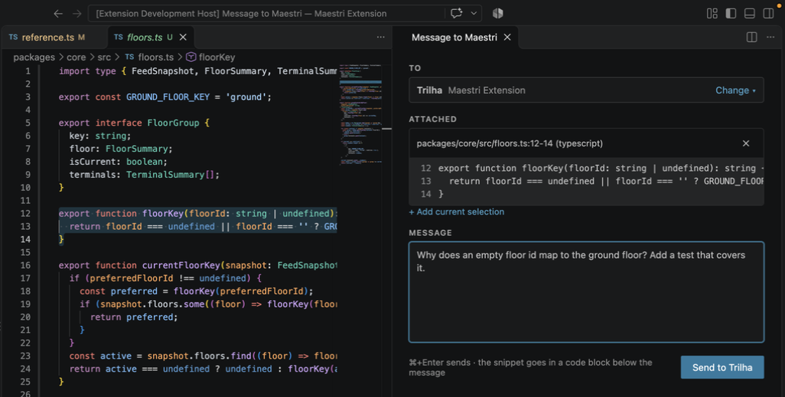
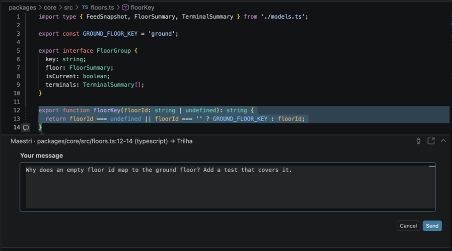
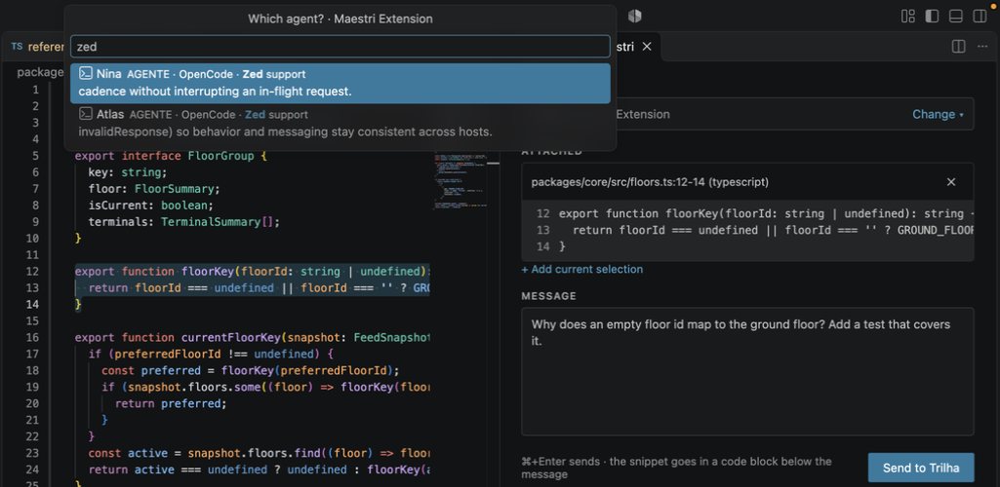
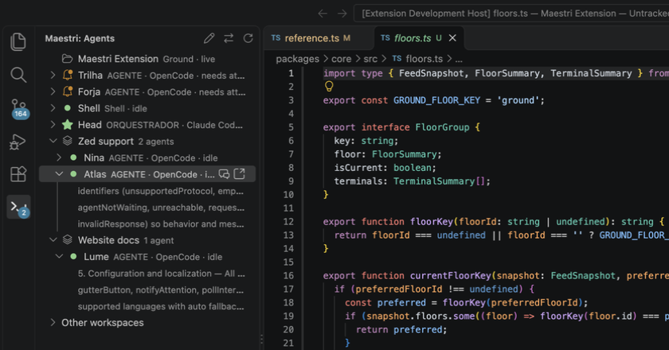

# Maestri Bridge

Send code snippets and messages from your editor to the agents and terminals running in [Maestri](https://www.themaestri.app), without leaving your code. Maestri Bridge talks to Maestri through [Wire](https://www.themaestri.app/docs/wire), Maestri's local API.



## Features

- **Inline message box.** Select code, press `Ctrl+M` and type. The box opens right below the selection and shows the file, the lines and the target agent.
- **Message panel.** Press `Ctrl+M` again to move to a side panel for longer messages. Attach several snippets, even from different files, and pick the agent.
- **Live agents sidebar.** See every agent in the current Maestri workspace with its status (working, idle, stopped, needs attention) and its latest output. From there you can write to an agent, open its terminal in Maestri and approve or reject a confirmation prompt.
- **Floors.** Agents on the current floor come first. Agents on other floors are grouped by floor name, and the agent search also matches floor names.
- **Agents show you code.** An agent can open a file in your editor, highlight lines and leave a note below them. Reply in the same box and the answer goes back to that agent. Several notes in a row become a tour you step through.
- **Attention alerts.** A notification shows up when an agent starts waiting for you.
- **Seven languages**, the same as Maestri: English, Portuguese (Brazil), Spanish, French, German, Japanese and Simplified Chinese.

Each message reaches the agent with a reference to where the code came from:

````text
Why does an empty floor id map to the ground floor? Add a test that covers it.

Reference: packages/core/src/floors.ts:12-14 (typescript)
```typescript
export function floorKey(floorId: string | undefined): string {
  return floorId === undefined || floorId === '' ? GROUND_FLOOR_KEY : floorId;
}
```
````

## Requirements

- Maestri with Wire turned on.
- VS Code 1.95 or later. Cursor, Windsurf and other editors based on VS Code work too.

## Install

1. Download [`maestri-bridge.vsix`](https://github.com/PierreOliveira1/maestri-bridge/releases/latest/download/maestri-bridge.vsix) from the [latest release](https://github.com/PierreOliveira1/maestri-bridge/releases/latest).
2. In VS Code, open the Extensions view, click `...` at the top and choose **Install from VSIX...**, then pick the file you downloaded.

Or install it from the terminal:

```sh
code --install-extension ~/Downloads/maestri-bridge.vsix
```

In Cursor, use `cursor --install-extension` instead of `code`.

To update, download the new release and install it the same way.

### Build from source

You need [Node.js](https://nodejs.org) 20 or later and [pnpm](https://pnpm.io).

```sh
git clone https://github.com/PierreOliveira1/maestri-bridge.git
cd maestri-bridge
pnpm install
pnpm package
code --install-extension integrations/vscode/maestri-bridge.vsix
```

## Pair with Maestri

You only need to do this once per computer.

1. In Maestri, turn on Wire and open the **Pairing** tab.
2. In VS Code, click **Maestri** in the status bar, or run **Maestri: Pair with Maestri** from the Command Palette.
3. Check that the security key shown by VS Code matches the one in Wire's **Manual** tab, then type the pairing code.

After the first connection, Maestri Bridge pins that security key. If the key ever changes, nothing is sent, not even the access token. The token is kept in VS Code's secret storage.

If Maestri runs on another computer, set `maestriBridge.host` to its address (an IP, a `.local` name or a Tailscale `.ts.net` name).

## Usage

### Write to an agent from the editor

Select some code and press `Ctrl+M` (`Ctrl+Alt+M` on Windows and Linux). A box opens below the selection with the cursor already inside it. Type your message and press `Cmd+Enter` (`Ctrl+Enter` on Windows and Linux), or click **Send**.



The header shows the file, the lines and the agent that will get the message. The buttons on the right of the header change the agent or open the message panel. By default, the target is the last agent you wrote to.

The box also opens from the `+` button in the editor margin, from the right-click menu and from **Maestri: Write to an agent (in the editor)** in the Command Palette.

### Use the message panel

Press `Ctrl+M` again, right after opening the box or while it has focus, to move to the message panel. The panel works better for longer messages:

- **To** shows the target agent. Click **Change** to pick another one.
- **Attached** lists the snippets. Select more code anywhere and click **Add current selection**. Remove a snippet with its `×` button.
- Type your message and press `Cmd+Enter`, or click **Send to ...**.

After sending, a confirmation shows up next to the button, with a link that opens the agent's terminal in Maestri.

The panel also opens from the right-click menu, from the Maestri sidebar and from **Maestri: Open message panel** in the Command Palette.

### Pick an agent

The agent list shows the current floor first, then the other floors, each under its own name. Type to search by agent name, role, status or floor.



### Follow your agents

Click the Maestri icon in the Activity Bar to open the sidebar.



- Each agent shows its role, the tool it runs and its status. Expand an agent to see its latest output.
- Agents on other floors are grouped under the floor name.
- Hover an agent to write to it or open it in Maestri.
- When an agent asks for confirmation, **Approve** and **Reject** buttons show up on its row.
- The buttons at the top open the message panel, switch to another Maestri workspace or floor, and refresh the list.

Maestri Bridge picks the Maestri workspace that matches the folder open in VS Code.

### Let agents show you code

Agents can also point at code for you. An agent opens a file in your editor, highlights the lines it's talking about and leaves a note below them.

- **Reply on the note.** Type in the box below the note and press `Cmd+Enter`. Your reply goes to that agent with the highlighted code attached, and shows up in the same box.
- **Step through a tour.** When an agent leaves several notes in a row, use the arrows at the top of each note, or **Maestri: Next agent note** and **Maestri: Previous agent note**, to go from one to the next.
- **Close notes** with the `×` on each note, or all at once with **Maestri: Clear agent notes**.

Agents do this by opening a `vscode://maestri-bridge.maestri-bridge/show?...` link. The easiest way to teach them is the [agent skill](#agent-skill) below. The first time, VS Code asks whether Maestri Bridge may open the link. Check **Do not ask me again for this extension** and click **Open**.

For safety, the extension only opens files inside the folders open in that window and only shows text: links can't run commands. To turn it off, set `maestriBridge.agentLinks` to `false`.

## Agent skill

The [`skills/maestri-bridge`](skills/maestri-bridge) folder is an [agent skill](https://agentskills.io) that teaches your agents to show you code. It has the instructions (`SKILL.md`) and a small script that builds and opens the link:

```sh
skills/maestri-bridge/scripts/show-in-editor.sh --new src/auth/session.ts:42-58 "This is where the token is refreshed."
```

To install it:

- **Claude Code:** copy the folder to `~/.claude/skills/` (for all projects) or to `.claude/skills/` in your project.
- **Other agents with skill support:** copy the folder to the skills directory your agent reads.
- **Agents without skills:** copy the script somewhere in your project and add a short note to your `AGENTS.md`, for example: *"To show me code, run `scripts/show-in-editor.sh FILE:START-END "note"`. Use `--new` for the first note of a walkthrough."*

The script runs on macOS, Linux and Windows (Git Bash or WSL). It uses `MAESTRI_TERMINAL_ID`, which Maestri sets in every terminal, so replies reach the right agent. To target Cursor, Windsurf, VS Code Insiders or VSCodium, set `MAESTRI_BRIDGE_EDITOR` to `cursor`, `windsurf`, `vscode-insiders` or `vscodium`.

## Settings

| Setting | Default | Description |
| --- | --- | --- |
| `maestriBridge.host` | `localhost` | Maestri address (an IP, `localhost`, a `.local` or a `.ts.net` name). |
| `maestriBridge.port` | `7434` | Wire port. |
| `maestriBridge.gutterButton` | `true` | Shows the `+` button in the editor margin. |
| `maestriBridge.notifyAttention` | `true` | Notifies you when an agent starts waiting for you. |
| `maestriBridge.pollIntervalSeconds` | `2` | How often, in seconds, agents are refreshed while VS Code has focus. Refreshing pauses while VS Code is in the background and slows down when Maestri doesn't answer. |
| `maestriBridge.agentLinks` | `true` | Lets agents open files in this window, highlight code and leave notes you can reply to. Only files inside the open folders are opened. |
| `maestriBridge.language` | `auto` | Extension language. `auto` follows VS Code and falls back to English. Command and menu names always follow the VS Code language. |

## Commands

All commands are under **Maestri** in the Command Palette.

| Command | What it does |
| --- | --- |
| Write to an agent (in the editor) | Opens the inline message box for the current selection. |
| Open message panel | Opens the message panel. |
| Quick send to agent (list) | Picks an agent from a list and sends the selection with a short message. |
| Pair with Maestri | Connects VS Code to Maestri. |
| Unpair from Maestri | Removes the saved access token. |
| Next agent note / Previous agent note | Steps through the notes an agent left in your editor. |
| Clear agent notes | Closes every agent note. |

## Project structure

| Folder | What it is |
| --- | --- |
| `packages/core` | Editor-independent core: Wire connection with a pinned key, pairing, workspaces, floors and terminals, live agent status, sending prompts and formatting code references. |
| `integrations/vscode` | The VS Code extension, built on top of the core. |

The core doesn't depend on any editor, so integrations for other editors (Zed is next) can reuse it.

## Contributing

Contributions are welcome. See [CONTRIBUTING.md](CONTRIBUTING.md).

## License

[MIT](LICENSE)
