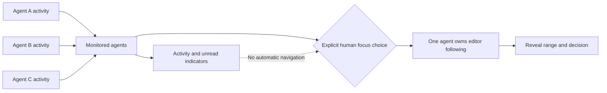

# 🧭 Agent following roadmap / Futuras funcionalidades

**Proposed roadmap, not a release commitment. / Roadmap proposto, sem compromisso de versão ou prazo.**

The cooperative single-focus feature is described in [agent-follow.md](agent-follow.md). Everything below is future work and is **not implemented by this PR**.

A versão cooperativa com um único foco está em [agent-follow.md](agent-follow.md). Tudo abaixo é evolução futura e **não está implementado neste PR**.

## 🇺🇸 English

| Priority proposal | Future feature | Value and dependencies | Acceptance proposal |
| --- | --- | --- | --- |
| P1 | 👥 Monitor multiple agents, keep one editor focus | Show activity/unread indicators for several explicitly chosen agents; preserve one viewport owner. Requires independent context/sequence handling per agent. | Non-focused monitored agents never change the active file. Switching focus is explicit, names/colors remain distinct, and stopping one subscription does not affect others. |
| P1 | 🔐 Host-authenticated activity | Bind publication to the actual terminal identity and authorized workspace/floor/root. Requires coordinated Maestri/Wire host and CLI support, capability negotiation and revocation. | The host rejects unauthorized producers, closed sessions and cross-context publication; the editor never silently falls back to an unauthenticated channel. |
| P1 | ⚡ Automatic post-write hooks | Publish completed editing operations without a manual helper call, while keeping partial tool coverage visible. Depends on officially supported tool/host hooks and context attribution. | A real write produces one bounded activity update. Failed tools do not claim a write; activity-delivery failure never repeats the code edit. |
| P2 | 💾 Safe session resumption | Preserve useful context across editor restarts without silently taking over navigation. Depends on a stable session lifecycle, durable metadata and revision checks. | Restore a paused summary only after validating agent/context/file. Human action resumes following; stale decisions and closed sessions are not replayed. |
| P2 | 🕰️ Bounded decision history | Review relevant explanations and changed-file locations without an endless comment stream. Requires stable decision IDs, limits and revision-aware anchors. | The history has explicit size/retention limits, deduplicates decisions, marks stale anchors and keeps replies bound to the original valid target. |
| P2 | 🌐 Remote and richer multi-root support | Support WSL/SSH/containers and unambiguous root mappings. Requires verified producer/editor URI and filesystem mapping. | A fixture in two identically named relative paths opens only in the selected root; remote/local path mismatches, junction escapes and disconnected mappings fail closed. |
| P2 | ✨ Motion, accessibility and recording polish | Improve pacing and subtle transitions where public editor APIs allow them; produce a continuous real-editor demo. Depends on API experiments and accessible alternatives. | No focus stealing or flashing; keyboard, screen reader, high contrast and reduced motion verified. Continuous video must contain real state changes and no private data. |

Priorities are discussion inputs. Host changes belong to the Maestri/Wire project and cannot be delivered by the Bridge repository alone.

### Future multi-agent interaction

## 🇧🇷 Português do Brasil

| Prioridade proposta | Evolução | Valor e dependências | Critério de aceite proposto |
| --- | --- | --- | --- |
| P1 | 👥 Monitorar vários agentes com um foco no editor | Exibir atividade/não lidos de agentes escolhidos explicitamente, mantendo um responsável pelo viewport. Exige contexto e sequência independentes por agente. | Agentes monitorados sem o foco não trocam o arquivo ativo. A escolha de foco é explícita, nomes/cores são distinguíveis e parar um acompanhamento não interfere nos demais. |
| P1 | 🔐 Atividade autenticada pelo host | Vincular publicação à identidade real do terminal e ao workspace/floor/raiz autorizados. Depende de suporte coordenado no Maestri/Wire e CLI, negociação de capability e revogação. | O host rejeita produtores sem autorização, sessões encerradas e publicação entre contextos; o editor não faz fallback silencioso para um canal sem autenticação. |
| P1 | ⚡ Hooks automáticos após a escrita | Publicar operações concluídas sem chamada manual ao helper, deixando explícita a cobertura parcial das ferramentas. Depende de hooks oficiais e atribuição de contexto. | Uma gravação real gera uma atualização limitada. Ferramenta que falhou não informa escrita; falha na entrega de atividade não repete a edição. |
| P2 | 💾 Retomada segura de sessão | Preservar contexto após reiniciar o editor sem assumir a navegação automaticamente. Depende de ciclo de vida estável, metadados persistentes e conferência de revisão. | Restaurar apenas um resumo pausado após validar agente/contexto/arquivo. O humano retoma; decisões antigas e sessões encerradas não são reproduzidas. |
| P2 | 🕰️ Histórico limitado de decisões | Revisitar explicações e localizações relevantes sem fluxo infinito de comentários. Exige IDs estáveis, limites e âncoras vinculadas à revisão. | Histórico com limites de tamanho/retenção, deduplicação, marcação de trechos antigos e respostas vinculadas ao alvo original válido. |
| P2 | 🌐 Suporte remoto e multi-root ampliado | Cobrir WSL/SSH/containers e mapear raízes sem ambiguidade. Depende de mapeamento verificado de URI e filesystem entre produtor e editor. | Dois caminhos relativos iguais abrem somente na raiz escolhida; diferenças remoto/local, escapes por junction e mapeamentos desconectados são recusados. |
| P2 | ✨ Movimento, acessibilidade e gravação | Refinar ritmo e transições sutis nas APIs públicas disponíveis; produzir demonstração contínua no editor real. Depende de experimentos de API e alternativas acessíveis. | Sem roubar foco ou piscar; teclado, leitor de tela, alto contraste e movimento reduzido verificados. Vídeo contínuo deve conter mudanças reais e nenhum dado privado. |

As prioridades servem à discussão. Mudanças no host pertencem ao projeto Maestri/Wire e não podem ser entregues somente neste repositório.

**Decision / Decisão:** monitor many, follow one editor focus at a time. / Monitorar vários, com um único foco no editor por vez.
